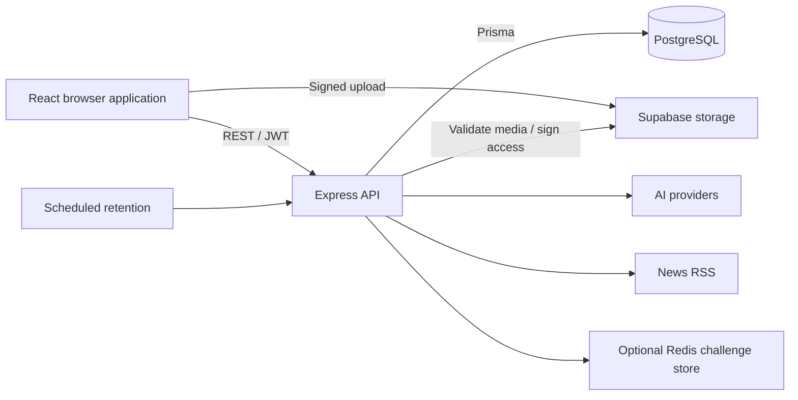

> Baseline audit at commit `7d1dcec`, before repairs. See [REMEDIATION.md](REMEDIATION.md) for the subsequent implementation and verification status. Findings below describe the original code.

# VEIL Social — project analysis

Reviewed: 15 October 2026. Baseline: `7d1dcec`.

## Overall assessment

VEIL Social is an anonymous social platform with a substantial frontend and an implemented backend. It includes pseudonymous and anonymous posts, comments, reactions, media uploads, direct messages, account security, AI writing assistance, and news. It is more than a UI prototype, but several visible features are still simulations or incomplete integrations.

**The current code should not be treated as ready for a public launch with its advertised privacy guarantees.** The most important problems involve media ownership, anonymous identity leakage, account deletion, serverless abuse protection, and privacy controls that do not affect server behavior. The production build succeeds, but that does not establish application correctness.

This review covered the repository structure, backend business logic, frontend routes and API integration, database schema and migrations, authentication, media, messaging, AI, retention, deployment configuration, and available checks. No application code was changed. This report is the only tracked addition; diagnostic fixtures and generated build outputs are ignored local files.

## What we will be working with

| Area | Current implementation |
| --- | --- |
| Repository | npm workspaces with `backend`, `frontend`, and root build/deployment scripts |
| Frontend | React 19, TypeScript, TanStack Start/Router/Query, Vite 8, Tailwind 4, Radix UI, Framer Motion |
| Backend | Express 4, JavaScript ES modules, Zod validation, Prisma 5.22 |
| Database | PostgreSQL; 14 Prisma models and 10 migration directories |
| Authentication | Argon2id password/passphrase hashing, JWTs with token-version checks, TOTP, passkeys, recovery codes |
| Media | Supabase private storage, signed uploads, FFprobe video validation, FFmpeg thumbnails, signed download redirects |
| Messaging | Browser ECDH P-256 + HKDF + AES-GCM for message text, IndexedDB private keys, REST polling |
| AI and news | Groq/xAI integration with Gemini fallback; Google News RSS; keyword/mock fallbacks when integrations are unavailable |
| Abuse controls | PostgreSQL rate-limit counters; optional Upstash Redis for temporary authentication state |
| Deployment | Combined Vercel static frontend + Express function, separate frontend deployment configuration, and Docker/container configuration |

The database groups naturally into accounts/security (`User`, `Passkey`, `RecoveryCode`, `SecurityEvent`, `LoginAttempt`), social content (`Post`, `Comment`, `Reaction`, `ModerationLog`), conversations (`Thread`, `ThreadParticipant`, `Message`), media (`Media`), and rate limiting (`RateLimitCounter`).

The main frontend screens are onboarding, social feed, composer, news, video, messages, profile/security, and safety/reporting. The main API families are authentication, posts/comments, reactions, chats, users, AI, RSS, media, and retention. Several API families have both `/v1/...` and `/api/v1/...` aliases.

### Important behavior and boundaries

- Pseudonymous posts keep an author relationship. Fully anonymous posts set `Post.userId` to `null`. That distinction also affects deletion and ownership.
- The browser requests an upload ticket, uploads directly to Supabase, confirms the upload through the backend, and then creates a post referencing the media.
- Post media is served through a post-based endpoint that returns a signed storage URL lasting 15 minutes. This is separate from chat participant authorization.
- Chat text encryption happens in the browser. The server still knows sender IDs, conversation participants, and message timing. The implementation does not provide the advertised sealed-sender protocol.
- Messaging uses repeated REST requests, including full message history requests, rather than WebSockets or incremental synchronization.
- Text moderation runs asynchronously after publishing. Some unavailable AI services return successful mock responses, so a successful API response does not necessarily mean a provider was contacted.
- Retention runs every 10 minutes in the long-running backend and daily in the checked-in Vercel schedule. It cleans up expired messages, inactive accounts, and expired free-tier video media.

### How development and builds currently work

`npm run dev` starts only the backend. The frontend runs separately with `npm run dev:frontend`. The root production build generates Prisma Client, builds/prerenders the frontend, and copies the client output to root `dist`.

The application requires PostgreSQL and appropriate environment configuration. The README's SQLite/no-external-dependencies description is obsolete. The current frontend dependency tree requires a newer Node runtime than the README's Node 18 guidance; Node 24.15.0 was used for this review, while CI selects Node 22.

## Feature status

“Implemented” below means the code path exists, not that a live production workflow was verified.

| Feature | Assessment |
| --- | --- |
| Registration, login, token invalidation | Implemented; positive isolated authentication checks passed; database integration still needs verification |
| TOTP, recovery codes, passkeys | Substantial implementation; serverless throttling, temporary-state persistence, counter handling, and concurrency need attention |
| Posts, comments, reactions, reposts | Implemented; deletion visibility and media ownership defects exist |
| Image/video uploads | Implemented; ownership and authoritative validation are incomplete |
| Anonymous publishing | Implemented at the post author field, but media metadata can reveal the associated account UUID |
| Private audience, post lifetime, engagement controls | Displayed in the composer but not persisted/enforced by the backend |
| Face pixelation | Partial browser implementation; can silently retain the original image and handles only the first detected face |
| Metadata removal/background blur | Controls exist, but those selections currently use the original file |
| Encrypted chat text | Cryptographic round trip passed locally; key lifecycle and expiry enforcement are incomplete |
| Chat attachments | Integration mismatch produces invalid media URLs; attachment bytes are not encrypted by the text encryption path |
| News feed and AI briefs | RSS implementation exists; generated brief requests can exceed backend validation limits |
| Incident reports and appeals | Local/demo behavior; reports are not delivered to a moderation backend |
| Premium waitlist | Success feedback without persistent enrollment |
| Following, polls, voice recording | Local state or presentation without complete supporting behavior |
| Bookmarks | Browser local storage rather than an account-synchronized backend feature |

## Highest-priority findings

Priority describes the order of repair, not a formal CVSS rating. “Fixture-confirmed” means actual application handlers or validation were exercised with controlled in-memory substitutes. It does not mean a live service was attacked.

### 1. Media ownership is not enforced at confirmation or post creation

**Priority: P1 — authorization and data integrity. Evidence: source + isolated handler fixtures.**

[Media confirmation](E:/VEIL_SOCIAL/backend/src/routes/media.routes.js:196) trusts caller-supplied `mediaId`, `storagePath`, `mimeType`, and `sizeBytes`. It does not bind confirmation to an upload issued to that user. Image confirmation does not inspect the uploaded object's actual bytes or size. A fixture successfully registered a foreign user path with a negative size without an upload.

[Post creation](E:/VEIL_SOCIAL/backend/src/controllers/posts.controller.js:104) also accepts foreign storage paths/media without an ownership check. The media deletion handler authorizes against the newly created media row, then removes its stored path with service credentials. Together these paths permit unauthorized references and potentially deletion of another user's stored object when its path is known. Live storage deletion was not attempted.

**Repair:** issue and persist an upload authorization bound to user, object, limits, and expiry; validate the actual stored object; allow posts to attach only verified, owned media; validate ownership again before deletion. Enforce positive sizes, MIME policy, and quotas on the server.

### 2. Anonymous media posts disclose an account identifier

**Priority: P1 — privacy. Evidence: source + isolated response fixture.**

[Post details](E:/VEIL_SOCIAL/backend/src/controllers/posts.controller.js:355) loads `media: true` and [spreads the post into the response](E:/VEIL_SOCIAL/backend/src/controllers/posts.controller.js:413). An anonymous post with `userId: null` still returns `media.userId` and storage paths containing the owner's UUID. Feed thumbnail metadata and signed storage paths can also expose that UUID.

This links content to an account identifier and can connect anonymous and pseudonymous activity; it does not by itself reveal a person's legal identity.

**Repair:** define explicit public response fields and use opaque storage naming/access paths that do not disclose author IDs.

### 3. Returning users can still be deleted as inactive

**Priority: P1 — irreversible data loss. Evidence: source + cleanup fixture.**

[Retention cleanup](E:/VEIL_SOCIAL/backend/src/services/cron.service.js:76) deletes users based on an elapsed `pendingDeletionAt`. Login and [authenticated activity](E:/VEIL_SOCIAL/backend/src/middleware/auth.middleware.js:42) update `lastActiveAt` without clearing that deadline. The deletion query does not recheck recent activity. An active-user fixture with an old deadline was selected for deletion.

**Repair:** cancel scheduled deletion on qualifying activity and revalidate inactivity atomically when deleting. Add a regression test covering return during the grace period before enabling the destructive job in a verified deployment.

### 4. The retention endpoint accepts a caller-controlled header as authorization

**Priority: P1 — unauthorized execution of destructive maintenance. Evidence: source + route fixture.**

[Cron authorization](E:/VEIL_SOCIAL/backend/src/routes/cron.routes.js:14) bypasses the secret check for `x-vercel-cron: 1` or `true`. A wrong bearer token was rejected normally but accepted after adding that header. Without `CRON_SECRET`, requests are accepted without authentication.

**Repair:** require the configured secret for every invocation and reject missing configuration. Vercel's documented mechanism supplies `Authorization: Bearer <CRON_SECRET>`; a custom request header is not proof of origin. [Vercel cron authentication documentation](https://vercel.com/docs/cron-jobs/manage-cron-jobs).

### 5. Vercel deployment skips initialization of the rate limiters

**Priority: P1 — authentication abuse and provider cost exposure. Evidence: source + middleware fixture.**

[Application boot](E:/VEIL_SOCIAL/backend/app.js:229) initializes the PostgreSQL limiters only outside Vercel and tests. The serverless entry point imports the app without another initialization path. [Rate-limit middleware](E:/VEIL_SOCIAL/backend/src/config/rateLimiters.js:136) allows requests when its limiter is missing. In a Vercel-mode fixture, the limiter map stayed empty and 25 AI requests passed a configured 20-request allowance.

Login, recovery, TOTP, and public AI endpoints therefore lack the intended middleware protection on this deployment path. In-memory fallback challenge state also needs review for multiple serverless instances.

**Repair:** initialize shared protection for every runtime and explicitly define behavior when the backing store is unavailable. Verify both long-running and serverless entry points.

### 6. Composer privacy choices do not match published behavior

**Priority: P1 — users can publish more broadly or retain content longer than intended. Evidence: source + schema fixture.**

The composer stores audience, lifetime, and engagement settings in local state, but [publishing](E:/VEIL_SOCIAL/frontend/src/routes/compose.tsx:444) sends only content, category, identity mode, and media. The [post schema](E:/VEIL_SOCIAL/backend/src/schemas/posts.schema.js:9) has no supported fields for those settings, and the database has no corresponding enforcement. A fixture confirmed that those extra fields are stripped by validation.

Choosing a circle/selected audience therefore does not create an access-restricted post. A selected lifetime does not cause post expiration, and engagement toggles do not enforce restrictions.

**Repair:** agree on the intended policy, persist it, enforce it on all reads/writes/reposts/media routes, and expose only choices that are actually supported.

### 7. Media privacy controls can claim success while retaining the original image

**Priority: P1 — privacy. Evidence: source tracing; no visual/device verification.**

[Media selection](E:/VEIL_SOCIAL/frontend/src/routes/compose.tsx:190) applies processing only to face-shield/pixelation selections. Metadata removal and background blur keep the original file. Face processing returns the original file on detection or processing failure, while the caller still displays a success toast. [Face detection](E:/VEIL_SOCIAL/frontend/src/lib/faceDetect.ts:51) uses only the first detected face. The backend anonymization service is an unused copy simulation.

**Repair:** return an explicit processing result, make failure visible, cover all intended faces, and verify metadata removal and transformations on real fixtures. Do not claim protection before it is applied.

### 8. Checked-in dependencies differ from the successfully built installation

**Priority: P1 release work; live exploitability not established. Evidence: manifests, lockfile, installed packages, official advisory.**

[Frontend dependencies](E:/VEIL_SOCIAL/frontend/package.json:52) pin `@tanstack/react-start` to `1.168.42`; the tracked frontend lockfile includes `start-server-core` `1.169.25`. These fall within the server-function XSS advisory's affected ranges. The local installation instead contains patched React Start `1.168.60` and core `1.169.39`, so `npm ls` reports an invalid tree. [Vercel configuration](E:/VEIL_SOCIAL/vercel.json:10) explicitly bypasses the vulnerable-version deployment guard.

The official fixes are React Start `1.168.60` and start-server-core `1.169.39`. The root deployment serves the static client with Express, so this review does **not** establish that the vulnerable server-function surface is exposed in production. [TanStack security advisory GHSA-qx66-fv34-fjm8](https://github.com/TanStack/router/security/advisories/GHSA-qx66-fv34-fjm8).

**Repair:** align manifests and a reproducible lockfile with patched packages, remove the bypass, and verify a clean installation. The passing local build cannot certify the currently declared dependency set.

## Other confirmed implementation problems

| Problem | Evidence and consequence | Suggested repair |
| --- | --- | --- |
| Valid zero-counter passkeys can be revoked | [Extra counter check](E:/VEIL_SOCIAL/backend/src/controllers/passkey/login.controller.js:150) rejects `0 <= 0`, even though the verification library supports authenticators without counters. Predicate reproduced; no hardware ceremony run. | Follow the library's verification semantics and test zero-counter credentials. [SimpleWebAuthn documentation](https://simplewebauthn.dev/docs/packages/server/). |
| Expired chat messages remain readable until cleanup | [History query](E:/VEIL_SOCIAL/backend/src/controllers/chats.controller.js:100) filters only by thread, not expiration; last-message previews also omit the expiry condition. Fixture returned an expired message. Daily cleanup can leave almost another day of visibility. | Enforce expiration during reads as well as physical cleanup; review media expiry similarly. |
| Deleted originals remain visible through reposts | [Feed formatting](E:/VEIL_SOCIAL/backend/src/controllers/posts.controller.js:303) returns nested shared-post content without filtering its deleted state. Fixture returned deleted text. Detail responses have the same pattern. | Apply a shared visibility policy to original posts, reposts, comments, and media. |
| Chat attachment URL uses the wrong identifier | [Chat upload](E:/VEIL_SOCIAL/frontend/src/routes/messages.$threadId.tsx:293) constructs a stream URL with a media ID; [streaming](E:/VEIL_SOCIAL/backend/src/routes/media.routes.js:32) looks up a post ID. A standalone attachment fixture produced 404. | Provide an attachment endpoint authorized by conversation membership. |
| Attachment bytes are outside text encryption | [Message API](E:/VEIL_SOCIAL/frontend/src/lib/api.ts:675) encrypts text while handling a separate media URL; storage uploads use the original file bytes. | Encrypt attachments before upload if end-to-end encryption is promised; define attachment-key exchange. |
| Key reset does not invalidate cached thread keys | [Reset handler](E:/VEIL_SOCIAL/frontend/src/routes/messages.tsx:104) replaces keys without calling [the cache-clearing function](E:/VEIL_SOCIAL/frontend/src/lib/api.ts:666). Cached keys also need account-switch and peer-key-change handling. | Add explicit key versions, cache invalidation, and reset/reload/multiple-device tests. |
| Account deletion does not clean up storage objects | [Account deletion](E:/VEIL_SOCIAL/backend/src/controllers/auth/profile.controller.js:103) deletes the database user; media rows cascade, but stored objects are not removed through this path. Retention has the same gap. | Capture object references before deletion and use retryable storage cleanup. Define treatment of fully anonymous posts, which have no author relationship. |
| News briefs can violate the API contract | [News generation](E:/VEIL_SOCIAL/frontend/src/routes/news.tsx:64) sends instructions/title/snippet as `topic`; [validation](E:/VEIL_SOCIAL/backend/src/schemas/ai.schema.js:10) limits it to 100 characters. A representative 136-character prompt was rejected. | Send a short topic and bounded context, and test realistic article lengths. |
| Reports and appeals are not delivered | [Safety page](E:/VEIL_SOCIAL/frontend/src/routes/safety.tsx:82) stores reports only in local storage; appeals simulate success with a timer. No corresponding report/appeal backend exists. | Implement persistence and an actual review workflow, or clearly disable unavailable submission. |
| Premium waitlist enrollment is not saved | [Profile waitlist](E:/VEIL_SOCIAL/frontend/src/routes/profile.tsx:385) changes component state and displays success. | Persist enrollment or remove the enrollment claim until available. |
| Separate frontend deployments can break media URLs | API requests use `VITE_API_URL`, but returned `/api/media/...` paths are consumed as frontend-origin URLs. | Resolve media URLs against the API origin and test combined and separate deployments. |
| Media-only composer submissions conflict with validation | The UI permits media without body text; the post schema requires at least one character. | Agree on media-only behavior and make both sides consistent. |

Other product gaps include synthetic-media filtering backed by a field absent from the schema, profile/video lists limited to their initial page, local-only follow state, and poll/voice presentations without a complete voting/recording flow. These should be converted into an explicit supported-feature list before further UI expansion.

## Engineering and operational gaps

### Reproducibility, CI, and documentation

- The root lockfile is ignored, while backend/frontend lockfiles are tracked. Workspace and per-folder installation paths need one agreed, reproducible strategy.
- A later ignore pattern also ignores `.env.example`, despite an earlier exception. The existing local templates are not available to a clean checkout.
- [CI](E:/VEIL_SOCIAL/.github/workflows/ci.yml) has no test PostgreSQL service or synthetic required environment configuration. It does not run frontend type checking or linting. `--passWithNoTests` does not address the existing integration tests' database requirements.
- Four schema indexes for security events, post feeds, and comments have no matching creation statements in the checked-in migrations. A migration-only fresh database will not gain those declared indexes. The deployed database was not inspected.
- README and previous audit documents describe obsolete behavior or claim readiness/checks that the current review does not support. They should be updated after the implementation is stabilized.

### Concurrency concerns requiring database-backed reproduction

- Reaction uniqueness includes nullable `postId`/`commentId` fields, with a read-then-create flow. PostgreSQL treats nulls as distinct in ordinary unique constraints, so the current constraint does not guarantee one such reaction under concurrent requests. Use appropriate target-specific uniqueness and atomic operations. [PostgreSQL constraint documentation](https://www.postgresql.org/docs/17/ddl-constraints.html).
- Recovery-code selection and consumption are not guarded by a single conditional redemption operation; simultaneous redemption needs a dedicated test and an atomic claim.
- Comment parent existence should also enforce that the parent belongs to the requested post.

These are source-level findings; concurrent database requests were not executed during this review.

### Scaling and resource use

Chat history polling retrieves an unbounded history repeatedly. Trending calculations scan active posts. Retention is sequential without demonstrated batching or a multi-instance lease. Video confirmation downloads and processes media within the request/function lifecycle. These paths need bounded inputs, pagination, execution timeouts, and workload testing before capacity claims.

The production build reports a roughly 971 KB minified MarkdownRenderer chunk (326 KB gzip), a 473 KB main chunk (151 KB gzip), and 203 KB CSS (31 KB gzip). These are build measurements, not measured page-load performance. Correctness and privacy repairs should precede broad performance refactoring.

## Verification performed

| Check | Observed result |
| --- | --- |
| Root `npm run build` | Passed, including frontend build and 10 prerendered routes. Required permission to run outside the sandbox because prerendering opens a local HTTP listener. |
| Frontend TypeScript | Failed: 3 TS2322 errors in [AppNav](E:/VEIL_SOCIAL/frontend/src/components/veil/AppNav.tsx:89), also lines 210 and 212, involving badge values rendered as React nodes. |
| Frontend ESLint | 343 errors and 7 warnings: 340 formatting errors, one `prefer-const`, two empty-block errors, and seven refresh/export warnings. |
| Prisma schema validation | Passed. This does not verify migration application or database contents. |
| Backend/API/script syntax checks | All 54 checked JavaScript files passed syntax checking. |
| Existing backend Jest suite | 2 helper tests passed; 3 database-dependent tests could not pass against a deliberately unreachable isolated database address. A real disposable test database is still required. |
| Installed dependency tree | Failed consistency check: local React Start version differs from the exact declared version. |
| Isolated negative probes | 12 observations reproduced: missing serverless limits; foreign/negative-size media confirmation; foreign post storage path; anonymous media identifier leak; deleted repost content; cron header bypass; active-account deletion; expired message reads; attachment-ID mismatch; news validation mismatch; zero-counter rejection; discarded composer controls. |
| Isolated positive probes | Backend AES-GCM round trip; recovery-code helper acceptance/rejection; current/stale/banned JWT checks; browser ECDH/HKDF/AES-GCM round trip with a nonextractable private key all passed. |

The diagnostic fixture is saved locally at [tmp/project-audit-probes.mjs](E:/VEIL_SOCIAL/tmp/project-audit-probes.mjs). It substitutes an in-memory database and blocks its fetch path. It is an audit aid, not a replacement for maintained integration tests. Some probes invoke handlers after supplying a fixture identity; the passkey probe checks the extra counter predicate rather than performing a real authenticator ceremony.

No real database records, storage objects, deployments, paid AI calls, or user accounts were modified. This review did not perform a live end-to-end browser/device test, inspect the deployed infrastructure, verify production storage policies, run a load test, or perform an exhaustive dependency/security certification. The build and positive cryptographic primitive checks do not establish complete privacy guarantees.

## Recommended order of work

1. **Make the environment reproducible.** Choose the deployment target and install strategy; align patched dependencies, lockfiles, safe environment templates, a disposable test database, and required CI checks.
2. **Fix authorization and destructive maintenance.** Repair media ownership, cron authentication, inactivity deletion cancellation/revalidation, and serverless rate limiting. Add focused integration tests before exercising cleanup against real data.
3. **Make privacy behavior truthful and enforced.** Remove identity-bearing public metadata, implement supported audience/expiry policies across all routes, fix deletion visibility, and make media transformations explicit and verifiable.
4. **Complete account and messaging reliability.** Repair passkey counter handling, recovery-code concurrency, attachment routing/encryption, key lifecycle, and expiry enforcement.
5. **Complete promised product flows.** Decide which reporting, appeals, waitlist, follows, polls, voice, and AI features belong in the initial release; implement those end to end and remove simulated success for the rest.
6. **Verify the chosen release.** Run clean-install CI, database integration tests, authenticated browser journeys, device passkey checks, storage deletion tests, and then targeted performance tests. Update product copy and project documentation to match the verified behavior.

The existing stack is sufficient for this repair work; the evidence does not require a framework rewrite. The first implementation task should be a bounded reliability/security repair rather than adding more screens.
